<!-- The Digital Atelier · generated plates live in assets/, built by build/build.py. Edit content there, not here. -->

<picture><source media="(prefers-color-scheme: dark)" srcset="./assets/00-cover-dark.svg"></picture>

<picture><source media="(prefers-color-scheme: dark)" srcset="./assets/01-foreword-dark.svg">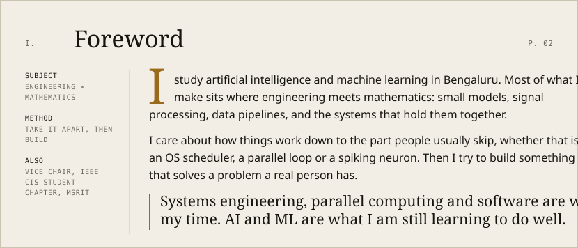</picture>

<picture><source media="(prefers-color-scheme: dark)" srcset="./assets/02-catalogue-dark.svg">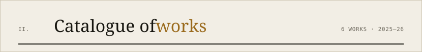</picture>

<a href="https://github.com/divishagera/nse-market-data-downloader"><picture><source media="(prefers-color-scheme: dark)" srcset="./assets/work-01-nse-dark.svg"></picture></a>

<picture><source media="(prefers-color-scheme: dark)" srcset="./assets/work-02-cortexcore-dark.svg">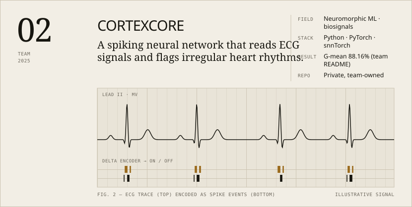</picture>

<a href="https://github.com/divishagera/Sayonara"><picture><source media="(prefers-color-scheme: dark)" srcset="./assets/work-03-sayonara-dark.svg">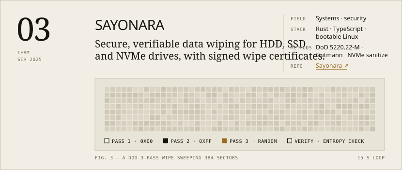</picture></a>

<a href="https://github.com/Ryan-gomezzz/Radcloud"><picture><source media="(prefers-color-scheme: dark)" srcset="./assets/work-04-radcloud-dark.svg">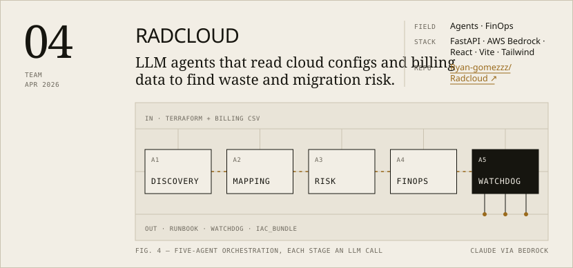</picture></a>

<picture><source media="(prefers-color-scheme: dark)" srcset="./assets/work-05-retrace-dark.svg">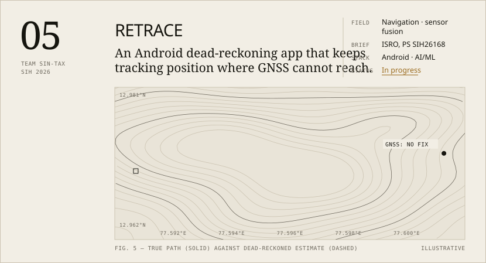</picture>

<picture><source media="(prefers-color-scheme: dark)" srcset="./assets/work-06-orbit-dark.svg">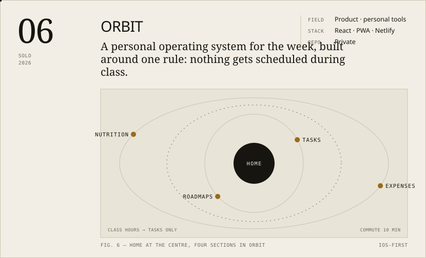</picture>

<picture><source media="(prefers-color-scheme: dark)" srcset="./assets/08-paper-dark.svg">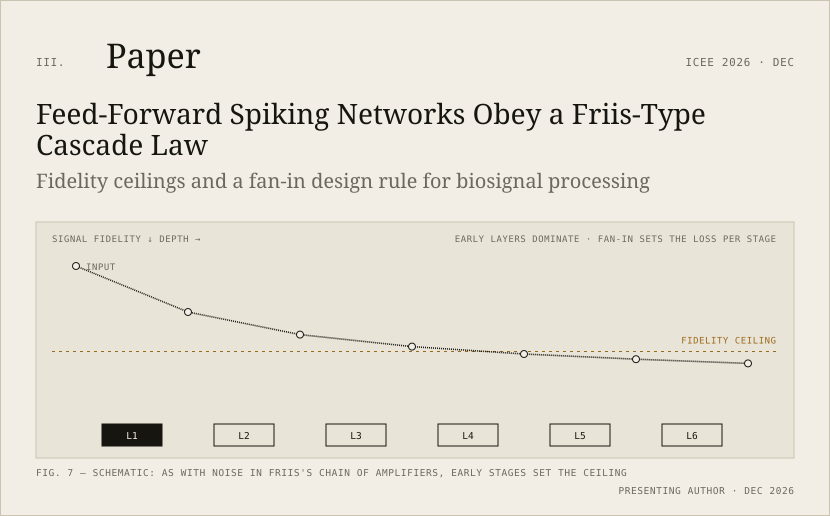</picture>

<picture><source media="(prefers-color-scheme: dark)" srcset="./assets/09-instruments-dark.svg">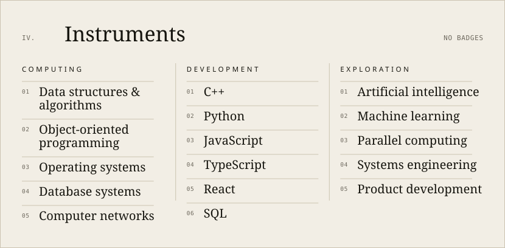</picture>

<picture><source media="(prefers-color-scheme: dark)" srcset="./assets/field-log-dark.svg">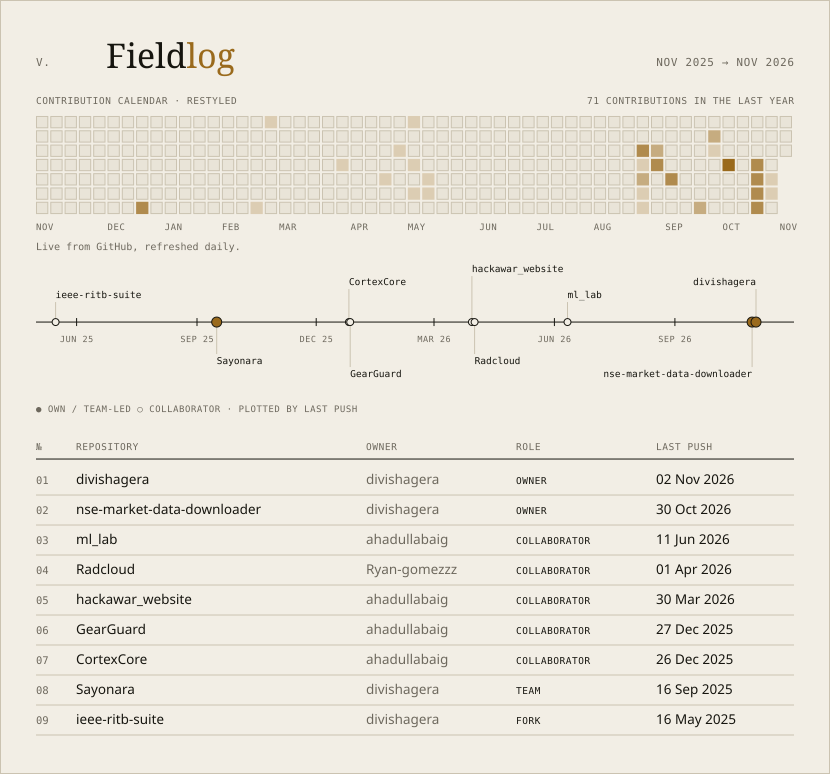</picture>

<picture><source media="(prefers-color-scheme: dark)" srcset="./assets/11-colophon-dark.svg">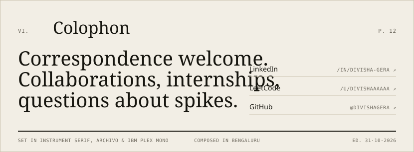</picture>

<a href="https://linkedin.com/in/divisha-gera">LinkedIn</a> &nbsp;·&nbsp; <a href="https://leetcode.com/u/divishaaaaaa/">LeetCode</a> &nbsp;·&nbsp; <a href="https://github.com/divishagera/nse-market-data-downloader">Latest work</a>

